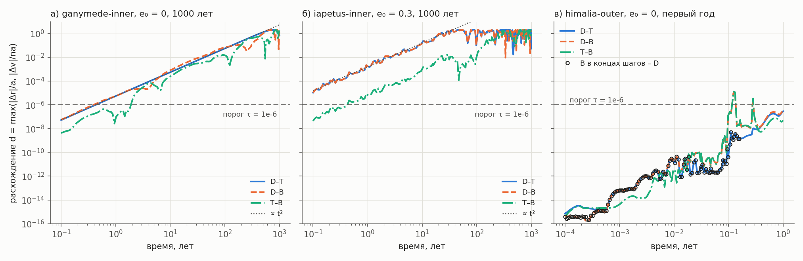

# W2-T008: разбор P2-1 — время расхождения и высокие эксцентриситеты

2026-10-12, claude-opus-20261012. Данные: `runs/W2-P2-1-55404980` (повторный P2-1 после W2-I017,
672/672, обязательный набор и расширение пройдены; D/T 10 000 лет — seed из 55200007 по W2-D021).
Новых платных расчётов нет; локально пересчитаны только два коротких задания B (раздел 1.4).
Согласование пользователя: «да» (2026-10-12 11:06 MSK) на разбор P2-R1/P2-R2 и предложение W2-D013.

*Рисунок. Расхождение пар d(t) = max(|Δr|/a, |Δv|/(na)) — то же определение, что в критерии τ.
а) круговая внутренняя орбита: D–T и D–B совпадают и растут как t²; T–B на 1–2 порядка ниже.
б) эксцентричная внутренняя орбита: ошибка D больше на 2–3 порядка, закон тот же.
в) himalia-outer: всплески D–B и T–B к 0.1 года — ошибка интерполяции внутри шагов IAS15; кружки —
B в концах шагов против D, они идут вместе с D–T.*

## Кратко

1. **Расхождение длинноживущих орбит — не хаос, а предел точности режима D.** Рост D–T степенной,
   d ∝ t^2.0…2.2, на 3–4 декадах времени; экспонента описывает данные в 2–5 раз хуже по разбросу.
   τ(D,T) воспроизводится независимыми заданиями с разными сетками и одинаков для орбит одной
   формы (a, e) при разных наклонах и фазах. τ(D,B) ≈ τ(D,T): ошибку определяет D.
2. **Исходы и ранние события от этого не зависят:** исходы D/T/B совпадают у 48/48 орбит на 1000 лет
   (D/T — и на 10 000 лет); события первого года совпадают по времени до 1e-13…1e-6 P0.
3. **Поздние контакты (12–3400 лет) сдвигаются до 38 P0, но эпоха совпадает до 7e-5 от времени
   события** — пороговый эффект медленно опускающегося перицентра. Сравнивать такие события нужно в
   масштабе вековой эволюции, а не 1e-6 P0.
4. **B не годится как поточечный эталон внутри длинных шагов IAS15** (новая W2-I019): у himalia-outer
   ошибка интерполяции до 1.3e-5 при согласии концов шагов с D до 5e-9. Ранние τ(D,B) у шести
   himalia-outer — артефакт, а не расхождение траекторий.
5. **Высокие e:** все 21 орбита с флагом — outer, и e ≥ 0.9 у них — терминальная фаза: событие
   наступает через 0.2–0.3 P0 (контакт) или 2.5–5.0 P0 (уход). Долгой жизни на высоких e нет ни у одной
   орбиты за 10 000 лет (максимум у остальных 27 — 0.884). Предложение правила — W2-D022 (раздел 2.3).

## 1. Время расхождения (P2-R1)

### 1.1. Метод

Скрипт `scripts/analyze_p2_divergence.py` строит для каждой орбиты и пары (D–T, D–B, T–B) кривую d(t)
на общей сетке стенда (0, 65 равномерных и 128 геометрических моментов) и подгоняет на участке
1e-13 < d < 1e-4 две модели: степенную (log d ~ p·log t) и экспоненциальную (ln d ~ t/λ). Разброс
подгонки — в декадах (dex). Подробно по всем орбитам: `results/evidence/W2_T008_P2-1_divergence_20261012/`
(`analysis.json`, `growth_short_horizons.json`).

### 1.2. Результаты по семействам

| Семейство | Орбит | τ(D,T), лет | Рост D–T (горизонт 10 лет) | τ(D,B) | τ(T,B), лет |
|---|---|---|---|---|---|
| inner, e₀ = 0 | 12 | 0.42–0.68 | p = 1.97–2.02; разброс 0.3–0.4 dex против 0.9–1.4 у экспоненты | ≈ τ(D,T) | 0.46–1.96 |
| inner, e₀ = 0.3 | 12 | 0.015–0.035 | p = 2.0–2.4; 0.1–0.2 dex против 0.3–1.0 | ≈ τ(D,T) | 0.32–0.46 |
| outer, выжившие (ganymede-, iapetus-outer-180-0.0) | 2 | 0.40; 12.9 | p = 1.7–1.9 | ≈ τ(D,T) | 4.0; 109 |
| outer, уход/контакт за < 5 лет | 22 | до события обычно нет | крутой рост, e-fold 0.05–0.2 года | см. 1.4 | — |

Подтверждения регулярного (не хаотического) характера у внутренних и выживших орбит:

- **Воспроизводимость.** τ(D,T) ganymede-inner-0-0.0 в независимых заданиях 1/10/100/1000 лет:
  0.438 / 0.442 / 0.434 / 0.459 года (различие — шаг сетки).
- **Зависимость только от формы орбиты.** Для 0°, 90° и 180° и сдвига фазы при том же (a, e) кривые D–T
  совпадают (одинаковые τ и параметры подгонки).
- **Количественная проверка экстраполяции.** iapetus-inner-90-0.0: по закону t² из τ(D,T) = 0.6 года
  фазовая ошибка D к контакту на 97-м году ≈ 1e-6·(97/0.6)² ≈ 0.026 рад, то есть ~4e-3 P0; наблюдаемый
  разброс времени контакта D/T — 4.9e-3 P0.
- **Механизм.** DOP853 не симплектичен: энергия (и средняя скорость) дрейфует линейно, фазовая ошибка
  растёт как t². Это свойство режима `NumericMode()` (rtol 1e-11), режим T на 1–2 порядка точнее.

Хаотический рост (крутой, экспоненциальный) виден только у короткоживущих outer-орбит перед уходом или
контактом; там событие обычно наступает раньше, чем расхождение достигает порога.

### 1.3. События

- Исходы D/T/B совпадают у всех 48 орбит на 1000 лет; D/T — у всех на 10 000 лет.
- События первого года (все контакты и уходы outer-орбит, ранние контакты inner): разброс времени
  1e-13…1e-6 P0 между всеми тремя вариантами (с B — до 2e-6 P0 у himalia-outer-180-*, см. 1.4).
- Контакты эксцентричных inner-орбит на 1.4–3.3 года: разброс 5e-4–2.3e-3 P0 (D/T/B).
- Поздние контакты inner-орбит (12–3426 лет): разброс от 5e-3 до 38 P0. Пример: iapetus-inner-90-0.0 —
  D/T 4.9e-3 P0, с B 15 P0. Перицентр опускается медленно, и какой виток первым пересечёт радиус
  контакта, решают различия ниже точности режима. Эпоха события при этом совпадает: разброс не больше
  7e-5 от времени события (himalia-inner-0-0.0: 38 P0 при P0 = 0.17 сут на 3427-м году — 5e-6).

### 1.4. B внутри длинных шагов (новая W2-I019)

Путь B (`engine_compare`, движок `ias15_reboundx`) вызывает `native.step(horizon)` без ограничения
шага, тогда как DOP853 ограничен 0.025 P0. У himalia-outer IAS15 делает ~110 шагов в год (медиана
2.8–4.2 сут, максимум 7.9 сут при P0 = 102 сут), и состояние в моментах сетки берётся из полинома
шага. Проверка (`b_interpolation_check.json`, локальный пересчёт B до 0.16 года, REBOUND 5.1.1):

| Орбита | B повторяет стенд | Интерполяция внутри шага | B в концах шагов против D |
|---|---|---|---|
| himalia-outer-90-0.0 | бит в бит | до 1.3e-5 | до 5.1e-9 |
| himalia-outer-180-0.0 | бит в бит | до 1.0e-7 | до 5.7e-10 |

Следствия: ранние τ(D,B) и τ(T,B) у шести himalia-outer — артефакт плотного вывода B; кривые T–B у
внутренних орбит шумные (0.3–0.5 dex) — часть этого шума, вероятно, тот же эффект, поэтому τ(T,B) —
нижняя оценка точности T. На итоги P2-1 не влияет (P2-Q2 проверяет события до τ; исходы совпадают).
Исправление-кандидат: ограничить шаг B тем же 0.025 P0, что у DOP853; решение — до использования B как
эталона в P2-2.

### 1.5. Что это значит для P2-2

- Поточечное совпадение траекторий D после ~0.02–0.7 года не ожидается и не требуется: фаза теряется
  регулярно, а исходы и вековая эволюция сохраняются. Критерии P2-2 — на уровне исходов и распределений.
- Времена поздних событий сравнивать в масштабе вековой эволюции (доля времени события или число
  витков), а не 1e-6 P0.
- Для эксцентричных внутренних орбит D теряет фазу за ~20–100 лет (d ≈ 1e-5 уже на 0.1 года). Если P2-2
  покажет зависимость статистики исходов от режима (D против T), это прямой довод в пользу T.

## 2. Высокие эксцентриситеты (P2-R2) и правило вместо W2-D013

### 2.1. Факты

| Семейство | Орбит с флагом | Исход | От первого e ≥ 0.9 до события |
|---|---|---|---|
| ganymede-outer | 6 | контакт 2, уход 4 | 0.20–0.30 P0 / 2.54–3.44 P0 |
| himalia-outer | 8 | контакт 1, уход 7 | 0.29 P0 / 2.47–3.50 P0 |
| iapetus-outer | 7 | контакт 1, уход 6 | 0.22 P0 / 2.55–4.98 P0 |

- Флаг стоит одинаково у D и T (42 строки = 21 орбита × 2); первое e ≥ 0.9 у D и T отличается не
  больше чем на ~3%.
- Исходы совпадают у D/T (10 000 лет) и D/T/B (1000 лет) для всех 21; времена событий D/T — до 2.4e-7 P0.
- Inner-орбиты флага не получают; максимум связанного e у 27 орбит без флага — 0.884 за 10 000 лет.
- Аудит W2-R010 (DOP853 при e = 0.99: ошибка скорости ~1e-3) относится к длительной эволюции на высоких e.
  В P2-1 высокая фаза короткая (≤ 5 P0) и ошибка не успевает накопиться — это видно по согласию D/T/B.

### 2.2. Рассмотренные варианты

1. **Любой выход в e ≥ 0.9 → unresolved.** Отбрасывает 21/48 (44%) — все уходы и контакты outer-орбит;
   статистика смещается к выжившим. Отклонено.
2. **Продолжение на B с момента флага.** Для этих случаев ничего не даёт (D/T и так согласны), B в
   текущем виде хуже в плотном выводе для outer-орбит (W2-I019) и в ~22 раза дороже за модельный год.
3. **Предлагается — терминальная фаза в допуске, длительная — нет** (2.3).

### 2.3. Предложение W2-D022 (заменит W2-D013 после согласования)

- Флаг `numerical_domain.outside_validated_domain` и время первого e ≥ 0.9 сохраняются как диагностика.
- **Терминальная фаза.** Если событие (контакт или уход) наступает не позже чем через **K = 10 P0** после
  первого e ≥ 0.9, исход скомпилированного режима принимается; запись помечается «высокие e,
  терминальная фаза». Основание: 21/21 случаев ≤ 5 P0, согласие D/T/B; запас ×2.
- **Длительная фаза.** Если связанное состояние с e ≥ 0.9 держится дольше K P0 без события, расчёт
  останавливается на t₁ + K·P0 с исходом `unresolved` («вне проверенной области»), как вычислительное
  цензурирование по W2-D018: вне знаменателя долей, отдельной строкой. В разработочном наборе таких
  случаев 0/48 за 10 000 лет; P2-2 измерит их долю на ансамбле. Если доля окажется заметной (> 1%),
  возвращаемся к маршруту через B — после исправления W2-I019.
- Реализация: изменение прототипа (останов по K·P0 и метка терминальной фазы) с тестами — отдельным
  шагом после согласования; новая версия прототипа меняет отпечаток D/T.

## 3. Стоимость (P2-R3)

Секунды счёта на модельный год (повторный P2-1, только P-ядра i9-14900KF; 10 000 лет — прежний
прогон на смешанных ядрах):

| Вариант | 1 год | 10 лет | 100 лет | 1000 лет | 10 000 лет |
|---|---|---|---|---|---|
| D | 0.69 | 0.88 | 0.99 | 1.02 | 1.69 |
| T | 1.35 | 1.73 | 1.96 | 1.98 | 3.37 |
| B | 14.3 | 18.2 | 21.9 | 22.0 | — |

T дороже D в ~2 раза, B — в ~22 раза. Рост к длинным горизонтам — доля долгоживущих внутренних орбит.

## 4. Ограничения

- 48 разработочных случаев, не вероятностная выборка; выводы о долях — не научные оценки.
- Подгонка роста — диагностика формы, а не оценка показателя Ляпунова; для внутренних орбит хаос не
  исключён на временах, больших горизонта, но в P2-1 он не проявляется.
- Проверка интерполяции B — на двух орбитах himalia-outer; масштаб эффекта для других семейств не измерен.

## 5. Файлы

- Скрипты: `scripts/analyze_p2_divergence.py`, `scripts/plot_p2_divergence.py`.
- Доказательства: `results/evidence/W2_T008_P2-1_divergence_20261012/` — `analysis.json`,
  `growth_short_horizons.json`, `b_interpolation_check.json`.
- Рисунок: `reports/analysis/W2_P2-1_divergence_20261012.png`.

## Дополнение 2026-10-12 (W2-T015, исправление W2-I019)

Замер `scripts/diag_ias15_dense_step.py` (`results/evidence/W2_T015_b_step_20261012/diag*.json`): ошибка
интерполяции B внутри шага в зависимости от предела шага.

| Орбита | без предела | 0.025 P0 | местное время, 0.025 | шагов/год (без → местное) |
|---|---|---|---|---|
| himalia-outer-90-0.0 | 1.3e-5 | 3.9e-8 | 5.9e-13 | 109 → 288 |
| himalia-outer-0-0.0 (тесный перицентр, r ≈ 0.36 a) | 1.3e-5 | 3.4e-6 | 3.1e-11 | 345 → 461 |
| himalia-outer-90-0.0-phase (r ≈ 0.2 a) | 1.3e-6 | 2.0e-6 | 2.0e-10 | 128 → 279 |
| ganymede-inner-0-0.0 | 4.8e-10 | 2.0e-10 | 1.3e-10 | 112 188 → 124 801 (+11%) |
| iapetus-inner-0-0.3 | 1.2e-11 | 4.0e-11 | 4.0e-11 | 56 950 → 67 467 (+18%) |

Принято: предел шага B = 0.025·min(P0, 2π·√(r³/GM хозяина)) по текущему расстоянию пробы
(`engine_compare.ias15_step_limit`); при r = a — та же доля, что у DOP853. Постоянный предел 0.025 P0 не
годится: у тесного перицентра ошибка остаётся 2–3e-6.

После исправления у шести himalia-outer (горизонты 1 и 10 лет) все 12 ранних τ(D,B) исчезли или стали
равны τ(D,T); τ(T,B) нет нигде; времена событий D–B совпадают до 7e-10…2.5e-7 P0, исходы одинаковы
(`himalia_outer_tau_before_after.json`).

**Поправка к §1.4:** предположение, что шум кривых T–B у внутренних орбит частично вызван той же
интерполяцией, **не подтвердилось** — у внутренних орбит ошибка интерполяции 1e-11…5e-10, на 3–4
порядка ниже уровня T–B. τ(T,B) внутренних орбит в P2-1 отражает реальное различие траекторий T и B.

Цена для будущих прогонов: у внутренних орбит B на 11–18% больше шагов; самое длинное задание B
1000 лет (ganymede-inner) — порядка 11.5 ч вместо 10.3 ч на P-ядре i9-14900KF.
